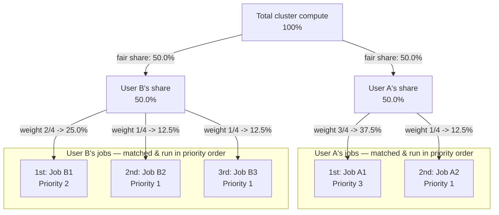
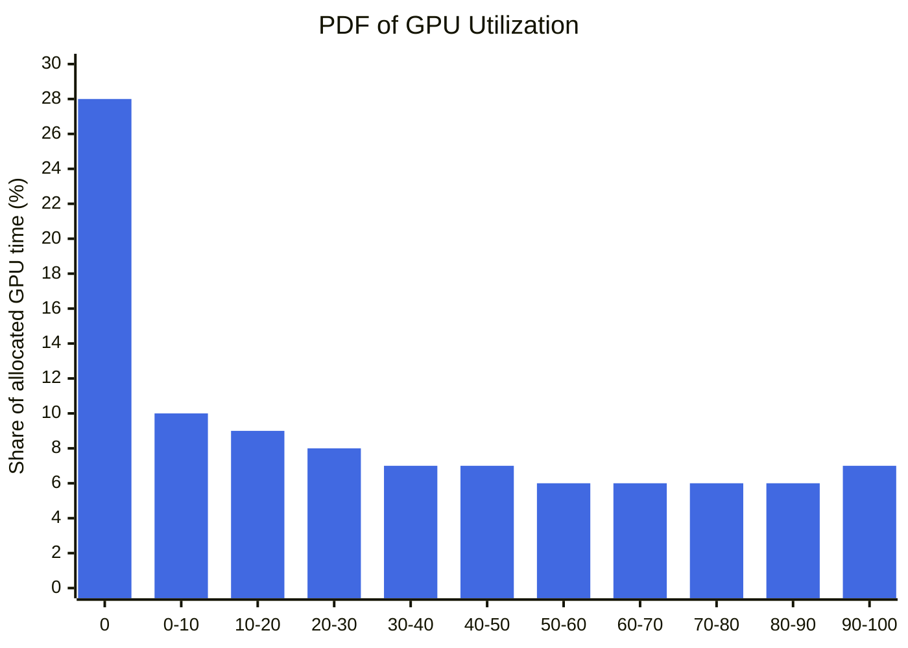

# The Big Product Design Picture

A primary goal in shared cluster environments is to achieve high system utilization while ensuring fairness and predictable performance for users. I begin by considering the problem of fair allocation of a single resource. Jobs are submitted by users in an online fashion and should be completed as fast as possible. GPUs are the most expensive resources in our cluster, and this makes their efficiency an important factor in assessing the cost-effectiveness across the entire cluster. On each scheduling iteration, I obtain fresh resource manager information, update my own state information, and schedule selected jobs. I determine the current available backfill windows and attempt to best fill these holes with the remaining jobs. Enabling backfill allows the scheduler to start other, lower-priority jobs so long as they don't delay the highest priority job.

## Who gets compute, under what guarantees, and why?

I express scheduling policies as optimization problems for various objectives of interest, such as fairness or makespan, and allocations as matrices that specify the fraction of wall-clock time a job should spend on each accelerator type between allocation recomputations. Users of our clusters run a highly diverse mix of workloads, with widely varying resource requirements and performance expectations. The resource manager is the ultimate authority that arbitrates resources among all the applications in the system. To address these requirements, admins classify workloads into distinct priority tiers and assign capacity quotas to manage contention:

| Who?    | Need                                                  | Constraint                                             |
| ---- | --------------------------------------------- | --- |
| Researcher | Deep learning (DL) training                                     | ~0.5% jobs take more than a week to be finished                    |
| Platform  | Minimize the maximum finish time fairness across all ML apps while efficiently utilizing cluster GPUs | Guaranteed zero temporary deadlocks       |
| Finance  | Maximum ROI for expensive accelerators                                 | Target >95% hardware utilization; strictly minimize idle time and capacity waste |

Metric-aware scheduling enables the scheduler to balance competing scheduling goals represented by different metrics such as job waiting time, fairness, and system utilization.

## Core principles of design

If a high-priority job arrives, evict low-priority jobs. Tasks can ask to be notified via a Unix SIGTERM signal before they're **preempted** by a SIGKILL, so they have time to clean up, save state, and[^1] take occasional checkpoints. The scheduler may decide to checkpoint the state of the job, and migrate it to another available machine to restart from that checkpoint rather than from scratch. Users experience preemption as a minor delay, not a restart, though how often that pause happens is set by priority.

**Priority** indicates the relative importance of a pod relative to other pods. If a pod can't be scheduled, the scheduler tries to preempt[^2] lower priority pods to make scheduling of the pending pod possible. Every job has a priority. I define priority bands for different uses, including[^3]: monitoring, production, batch, and best effort[^4]. This fair share is based on the user priority. 

*Figure BGDP-1*

The scheduler orders pending pods by their priority and a pending pod is placed ahead of other pending pods with lower priority in the scheduling queue. A high-priority task can obtain resources at the expense of a lower-priority one, even if that involves preempting[^5] the latter. I won't starve the lower priority user; I'll preempt only enough jobs so that the higher priority user's fair share can be realized[^6].

Queues may be allocated resources beyond their shares when other queues aren't using them. **Dominant resource fairness**, a generalization of max-min fairness to multiple resource types such as CPU and memory, computes the share of each resource allocated to a user and can also be seamlessly applied to a hierarchy of organizations, teams, and users.

Kubernetes hides the details of the underlying machines and network topology, allowing developers to focus on application logic rather than where containers are deployed. At Google's scale, devs can't worry about individual machines. Borg hides the details of cluster architecture, operating systems, and network interconnects from its users. Users specify what they want, not the individual machines they run on.

Kubernetes' design is a direct descendant of Borg's. Borg provides a web browser interface to examine the state of all jobs. If a task is pending, I explicitly answer the "why is my job pending?"[^7] question. Other data is tracked by monitoring tools for dashboards for a user to manage and view their jobs and tasks. To maintain trust, Borg itself surfaces this backend data and admits, schedules, starts, restarts, and monitors the full range of applications. I provide an estimate for the job start time. The fraction of a cell's total resource capacity allocated during each hour-long interval. Users can inspect task execution history, including preemption events and their reasons. Cluster resource utilization and idle capacity are tracked and visualized over time. Evictions per task-week: machine shutdown, other, out of resources, machine failure, preemption. It estimates the amount of resources a task will use and reclaims the rest.

## Policy

**Backfilling** allows short jobs to skip ahead provided they do not delay the job at the head of the queue. Backfill is a scheduling optimization which allows a scheduler to make better use of available resources by running jobs out of order.

**Gang scheduling** is a scheduling algorithm for parallel systems that schedules related threads or processes to run simultaneously on different processors. DL training jobs require all required resources to be allocated together. Training on large datasets often requires the use of multiple GPUs, and machine learning frameworks typically require that tasks on each GPU be scheduled at the same time. The cluster scheduler thus forces partially available resources to idle in reserve until the final request is satisfied. The more resources a job requires, the more GPU cycles are wasted when in idle waiting mode due to partial resource reservation. They're temporarily deadlocked and hoarding GPUs until at least one of them gives up and fails.

## User experience

A scheduler is a product, not just an infrastructure component. The scheduler determines when, where, and how to run jobs that are submitted.  A preempted workflow will fail with the `FAILED_PREEMPTED` status.

The **command-line interface (CLI)** allows users to interact with the system from a terminal. Specify the total number of GPUs required for the job. An optional GPU type specification can be supplied. These codes identify the reason that a job has not been started by the scheduler. To cancel a running job use the `cancel` command with the job ID. The `logs` command can be used to stream the logs of a running job. The CLI provides commands for submitting, monitoring, and managing jobs.

## Queue

The fair-share component to a job's priority influences the order based on the portion of the computing resources they have been allocated and the resources their jobs have already consumed.

## Scheduling

What's needed is a scheduler that simultaneously optimizes near-term decisions and the longer-term plan in the face of unknown future job submissions. In constraint-based scheduling, a feasible schedule can be constructed by starting with all candidate tasks and iteratively removing conflicting jobs until no constraints are violated. Scheduling decisions must always be made without knowledge of any future jobs. Preempting a DDL job from its GPUs can be expensive because data and model must be copied back and forth between the main memory and GPU memory. Moreover, systems are expected to guarantee stringent SLAs for production jobs and minimize latency for best-effort jobs.

Backfill scheduling will start lower priority jobs if doing so does not delay the expected start time of any higher priority jobs. Processor reservation solves the problem of an indefinitely pending large job by reserving job slots as they become available until there are enough reserved job slots to run the parallel job. Small jobs can run and finish before the large job starts. My configuration may be changed without disrupting any jobs.

## Trust

Predictability is the foundation upon which trust is built. Fair queueing provides several advantages over the FCFS queueing algorithm: fair allocation of bandwidth, lower delay for sources using less than their full share of bandwidth, and protection from ill-behaved sources. If the packet switches queue on a strictly first in, first out basis, the badly-behaved host will interfere with the transmission of data by better-behaved hosts.

Unexplained waits are longer than explained waits. Trust isn't a binary property that a system possesses or lacks but rather a multi-dimensional construct comprising distinct, contextual evaluation criteria. Each of these definitions seems to capture a different aspect of our everyday usage of "trust"; this suggests that trust is a multidimensional construct.

I trace the path of a single request as it traverses through the distributed system. If a job requiring 64 pods is created and there are only enough resources to schedule 46 pods, then 64 pods of the job will stay pending until all required GPUs are simultaneously available.

1. Providing an explicit estimated time of completion improves system *predictability* compared to an indeterminate progress indicator.
2. *ETA comes with a reason attached* - 64 requested, 46 available - instead of a bare number, which is exactly the question I answer when a job is pending.
3. *Procedural fairness* is what that reason forecloses: without it, a stalled job invites the suspicion that another team simply outranks this one, or was handed a bigger fair-share slice; with it, there's nothing left to suspect.
4. *Control* is the researcher not just watching the clock - they could attach a checkpoint against being preempted later, or shrink the request to fit inside the 46 GPUs already sitting idle.
5. And *reliability* is the one dimension that only gets tested afterward: if the job does start and then gets preempted an hour in, does it resume from the checkpoint, or restart from scratch? 

Leave any one of these five unanswered, and the wait stops feeling like whatever the clock says it is.

If the available resources aren't sufficient, the user job waits in a queue until the currently running job is finished and available resources are secured, resulting in a queue waiting time. When a system tells users roughly how long a queued task will take, that information - more than the length of the delay itself - is what eases their uncertainty and keeps them willing to wait. 

## Metrics

The measurement process also surfaces a number of infrastructure gaps that contribute to idle behavior. To assess the idle time of GPUs allocated to jobs, I separate the GPU utilization of zero from other ranges in the probability distribution function histogram plot.

*Figure BPDP-2*

High-performance GPU clusters typically target a 95% utilization threshold to maximize hardware efficiency. The median queue time in large-scale deep learning clusters often exceeds an hour, significantly impacting user productivity. Tracking preemption rates allows administrators to quantify how frequently a job suffers interruption due to cluster contention. The key takeaway is that limiting preemption - reducing how often jobs are interrupted and rescheduled - can lead to better memory utilization while maintaining a reasonable response time. Response time is defined as the total amount of times it takes for the system to respond to a task's request.

Goodput is more expressive than using memory utilization or number of models loaded; it captures the meaningful work a GPU completes. The GPU resources’ idleness can be attributed to the current configuration of GPU-accelerated nodes, which aren't allowed to be shared by jobs at the same time. To address this issue, I provide the API for graphics memory control. Capacity waste measures resources that are allocated but fail to perform useful work, distinguishing it from raw utilization metrics.

## Conclusion

State-of-the-art schedulers don't exclusively focus on maximizing resource utilization. They balance trade-offs between job completion time, fairness, and execution cost. An ideal resource manager remains largely invisible to the application developers while efficiently managing underlying hardware. Dynamic power management and resource allocation are tightly coupled in modern cluster schedulers. A predictable and fair scheduler is crucial for establishing user trust in shared cloud environments.

[^1]: if appropriate
[^2]: evict
[^3]: in decreasing-priority order
[^4]: also known as testing or free
[^5]: killing
[^6]: based upon the ratio between user priorities
[^7]: not enough memory
